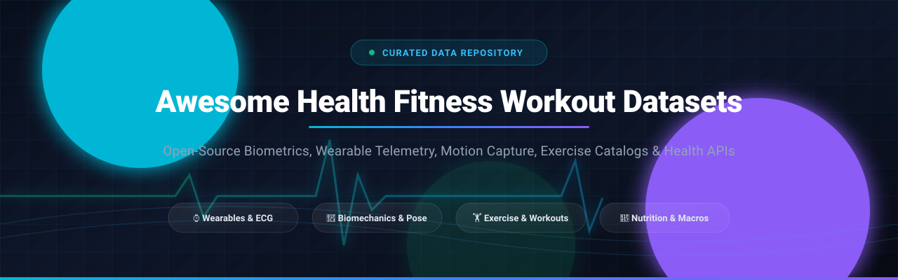

  

# 🏋️‍♂️ Awesome Health Fitness Workout Datasets

  
  
  
  
  

> 🌟 **Top Health, Fitness & Workout Datasets (Open-Source & Cloud Platforms)** — A production-ready, curated index of machine-readable fitness databases, exercise taxonomies, wearable biometric telemetry (ECG, PPG, IMU, heart rate), biomechanics motion capture (MoCap) sequences, pose estimation benchmarks, sports performance analytics, and open nutrition databases.

---

## 📑 Table of Contents

- [📊 Sector Overview & Market Dynamics](#-sector-overview--market-dynamics)
- [☁️ SaaS & Hosted Data Platforms](#️-saas--hosted-data-platforms)
- [🔓 Open-Source Equivalents & Datasets](#-open-source-equivalents--datasets)
  - [🏋️ Exercise & Workout Databases](#️-exercise--workout-databases)
  - [⌚ Wearable Biometrics & Activity Recognition Datasets](#-wearable-biometrics--activity-recognition-datasets)
  - [🏃 Biomechanics, Pose & Motion Datasets](#-biomechanics-pose--motion-datasets)
  - [🥗 Nutrition & Food Databases](#-nutrition--food-databases)
  - [📈 Telemetry Parsers, Self-Hosted Trackers & Health Data Aggregators](#-telemetry-parsers-self-hosted-trackers--health-data-aggregators)
- [📈 Star History](#-star-history)
- [💖 Support & Sponsorship](#-support--sponsorship)
- [🤝 Contributing](#-contributing)

---

## 📊 Sector Overview & Market Dynamics

The global wearable technology and digital health market is valued at approximately **$90B–$100B+** (projected to surpass $250B+ by 2030), with the underlying health data integration and healthcare API infrastructure market representing roughly **$1.3B–$2.0B**. The sector is **moderately fragmented**: while foundational wearable consumer hardware has major players (Apple, Google/Fitbit, Garmin, Samsung), the software ecosystem of biometrics, research platforms, remote patient monitoring (RPM), and data normalization APIs remains fragmented across specialized niche aggregators and multi-device middleware providers competing against custom proprietary vendor APIs.

---

## ☁️ SaaS & Hosted Data Platforms

Commercial, cloud-hosted platforms, proprietary data marketplaces, and managed wearable APIs for health, fitness, and athletic telemetry.

| Platform | Description | Size (Revenue / Valuation) | Starting Pricing | Free Tier / Trial Limits |
| :--- | :--- | :--- | :--- | :--- |
| **[Strava Metro](https://strava.com)** | Aggregated, de-identified human-powered mobility, running, and cycling geospatial data for urban planning and public transit research. | **$2.2B Valuation** (~$415M–$490M ARR) | **Free** for qualified public sector / academic partners; commercial enterprise data licensing starts at custom quotes ($10,000+/yr) | **Free indefinitely** for qualifying municipal agencies, transportation departments, active transit advocacy groups, and approved university researchers via Metroview application. |
| **[Validic](https://validic.com)** | Enterprise digital health IoT and remote care platform aggregating biometrics and connecting wearables/RPM devices into EHR systems. | **$31.6M Total Funding** (Acquired by ChartSpan, 2026; est. $10M–$25M ARR) | Developer tier is free; production/commercial deployment tiers start at **$500/month** (scaling with connected active patient volume and EHR integration depth) | **Free Developer Tier** available for testing, prototyping, and sandbox integration with synthetic and developer test devices. |
| **[Human API](https://humanapi.co)** | Health data aggregation network connecting consumer wearables, wellness apps, and EHR/clinical records. | **$36M–$44M Total Funding** (Acquired by LexisNexis Risk Solutions / RELX; est. $5M–$10M ARR) | Enterprise production data access starts at **$500/month** (scaling with volume of retrieved health and wellness records) | **30-day free developer sandbox** with access to sample and test patient health/wellness data connections. |
| **[Terra API](https://tryterra.co)** | Unified developer API providing normalized access to health, sleep, and fitness data across 500+ wearables and fitness apps. | **$2.8M Seed Funding** (est. $1M–$3M ARR) | **$399/month** (annual billing) or **$499/month** (monthly billing) including core integrations and active user credit pool; streaming API available at +$99/month | **No permanent free tier**; offers a **30-day money-back evaluation guarantee** on standard plans, and up to $100,000 in credits over 6 months via competitive application to the Terra Startup Accelerator. |
| **[Fitrockr](https://fitrockr.com)** | Research and fleet management SaaS specialized in raw high-resolution sensor extraction and analytics from Garmin smartwatches. | **Profitable / Bootstrapped** (est. $500K–$1.5M ARR; 40%–87% annual revenue growth) | **$27.50 per connected device** (minimum 3-month commitment, including hosting and unlimited admin/user accounts) | **14-day free trial** with full access to test Garmin device fleet management and data export tools. |
| **[Fitabase](https://fitabase.com)** | Cloud data aggregation and device management platform for clinical research studies using Fitbit and Garmin devices. | **Bootstrapped** (~$200K–$300K ARR; Small Steps Labs LLC) | **$10 per participant per month** (billed as participant-month credits for the study duration) | **14-day free trial** for research teams to test device pairing, data syncing, and study management workflows. |

---

## 🔓 Open-Source Equivalents & Datasets

Free, open-source datasets (FOSS), public repositories, and self-hosted software alternatives for exercise catalogs, biometric telemetry, motion analysis, and wearable data aggregation. Repositories in each section are sorted by GitHub star count (descending).

### 🏋️ Exercise & Workout Databases

Structured catalogs of strength exercises, calisthenics, gym routines, muscle target maps, and workout taxonomies.

* **[Exercises Dataset (hasaneyldrm)](https://github.com/hasaneyldrm/exercises-dataset)**  - Comprehensive open-source structured dataset of gym and fitness exercises with muscle categories, mechanics, and equipment tags.
* **[wger Workout Manager](https://github.com/wger-project/wger)**  - Free, open-source self-hosted fitness, workout, and body weight tracker with a rich REST API and community exercise database.
* **[Free Exercise DB (yuhonas)](https://github.com/yuhonas/free-exercise-db)**  - Public domain JSON database detailing over 800 strength training exercises with demonstration images, instructions, and muscle anatomy classifications.
* **[wrkout Exercise DB](https://github.com/wrkout/exercises.json)**  - Clean, developer-friendly JSON collection of exercise names, aliases, target body parts, and muscle groups.
* **[RepDB Exercise Dataset](https://github.com/RepDB/exercise-dataset)**  - Curated workout movement catalog mapped with primary/secondary muscle targets and execution cues.
* **[OpenFitness](https://github.com/openfitness)** - Open schemas and machine-readable data structures for workout routines, set/rep schemas, and exercise definitions.

---

### ⌚ Wearable Biometrics & Activity Recognition Datasets

Physiological telemetry, heart rate variability (HRV), electrocardiography (ECG), photoplethysmography (PPG), and IMU sensor streams from smartwatches, chest straps, and medical wearables.

* **[WFDB Python (PhysioNet Toolkit)](https://github.com/MIT-LCP/wfdb-python)**  - Official native Python library for downloading, reading, and writing PhysioNet physiological signal recordings (ECG, PPG, blood pressure, accelerometry).
* **[DeepConvLSTM (Wearable Activity Recognition)](https://github.com/STRCWearlab/DeepConvLSTM)**  - Deep learning convolutional LSTM architecture and benchmark code for human activity recognition from wearable sensor telemetry.
* **[Open mHealth Schemas](https://github.com/openmhealth/schemas)**  - Open standard JSON schemas designed to normalize clinical and consumer biometric data (heart rate, step cadence, physical activity, sleep intervals).
* **[PAMAP2 Physical Activity Monitoring Dataset](https://archive.ics.uci.edu/dataset/231/pamap2+physical+activity+monitoring)** - Landmark UCI dataset of 18 physical activities (walking, cycling, rowing, running) collected from 9 subjects using 3 IMUs and heart rate monitors.
* **[WISDM Smartphone & Smartwatch Activity Dataset](https://archive.ics.uci.edu/dataset/507/wisdm+smartphone+and+smartwatch+activity+and+biometrics+dataset)** - Open accelerometer and gyroscope time-series data from smartwatches and smartphones capturing everyday workouts and locomotive tasks.
* **[WESAD (Wearable Stress & Affect Detection)](https://archive.ics.uci.edu/dataset/465/wesad+wearable+stress+and+affect+detection)** - Multimodal dataset containing high-resolution physiological sensor data (ECG, EDA, EMG, respiration, skin temp) from wrist- and chest-worn devices.
* **[MHEALTH Dataset](https://archive.ics.uci.edu/dataset/319/mhealth+dataset)** - Mobile health benchmark capturing body motion, 2-lead ECG, and 3D inertial kinematics across 12 distinct physical exercise drills.
* **[PPG-DaLiA](https://archive.ics.uci.edu/dataset/495/ppg+dalia)** - Wearable dataset dedicated to PPG-based heart rate tracking under severe motion artifacts during exercise and daily living.
* **[Opportunity Activity Recognition Dataset](https://archive.ics.uci.edu/dataset/226/opportunity+activity+recognition)** - High-density sensor telemetry benchmark from on-body wearables and ambient ambient environments during naturalistic movements.

---

### 🏃 Biomechanics, Pose & Motion Datasets

Kinematic tracking, computer vision pose estimation, repetition counting, and 3D motion capture sequences for athletic movement analysis.

* **[Human Pose Estimation PyTorch (Microsoft Research)](https://github.com/microsoft/human-pose-estimation.pytorch)**  - Reference implementation for 2D human pose estimation with state-of-the-art keypoint detection on benchmark fitness and action datasets.
* **[Human (vladmandic)](https://github.com/vladmandic/human)**  - Ultra-fast 3D human pose, joint tracking, body segmentation, and gesture recognition library optimized for client-side and edge performance.
* **[Awesome Human Pose Estimation](https://github.com/cbsudux/awesome-human-pose-estimation)**  - Curated directory of 2D/3D human pose estimation datasets, athletic benchmark datasets, and cutting-edge vision papers.
* **[Fairmotion (Meta AI)](https://github.com/facebookresearch/fairmotion)**  - Framework and toolset by Meta AI Research for loading, processing, and visualizing 3D athletic motion capture (MoCap) data.
* **[OpenCap Core](https://github.com/stanfordnmbl/opencap-core)**  - Stanford NMBL open-source markerless 3D kinematics and biomechanics estimation framework transforming iOS/web video into joint motion analysis.
* **[Human3.6M](http://vision.imar.ro/human3.6m/description.php)** - 3.6 million 3D human poses and synchronized video sequences across 15 everyday scenarios, exercises, and sporting actions.
* **[Countix Exercise Repetition Dataset](https://www.robots.ox.ac.uk/~vgg/data/countix/)** - Large-scale video benchmark derived from Kinetics focused on repetitive workout motions (squats, pushups, lunges, pullups).
* **[Penn Action Dataset](http://archive.ics.uci.edu)** - 2,326 video sequences annotated with 2D human joint coordinates across 15 sports and gym exercise action categories.
* **[MM-Fit](https://mm-fit.github.io)** - Multimodal workout dataset combining synchronized smartwatch/earbud IMU signals with multi-view RGB-D camera feeds.

---

### 🥗 Nutrition & Food Databases

Nutrient profiles, micronutrient breakdowns, open product barcode registries, and dietary data schemas.

* **[Open Food Facts Server](https://github.com/openfoodfacts/openfoodfacts-server)**  - Open-source backend powering the world's largest crowdsourced, collaborative food and nutrition product database (over 3M+ items).
* **[Open Food Facts AI](https://github.com/openfoodfacts/openfoodfacts-ai)**  - Computer vision and machine learning models for nutritional label extraction, barcode recognition, and ingredient parsing.
* **[USDA FoodData Central](https://fdc.nal.usda.gov)** - Definitive US Department of Agriculture database providing open public access to detailed nutrient analysis of foods and agricultural products.
* **[Open Nutrition](https://github.com/open-nutrition)** - Open-source nutritional data models and barcode lookup utilities designed for privacy-respecting diet and macro calculators.

---

### 📈 Telemetry Parsers, Self-Hosted Trackers & Health Data Aggregators

Self-hosted workout management platforms, GPS/FIT/GPX activity telemetry parsers, and independent fitness telemetry dashboards.

* **[Gadgetbridge](https://github.com/Freeyourgadget/Gadgetbridge)**  - Free and open-source Android application to use smartwatches, fitness bands, and wearable heart rate sensors without vendor cloud accounts.
* **[GoldenCheetah](https://github.com/GoldenCheetah/GoldenCheetah)**  - Leading open-source performance analytics platform for cyclists, runners, and triathletes; parses Garmin FIT, TCX, and SRM telemetry.
* **[Workout Tracker](https://github.com/jovandeginste/workout-tracker)**  - Self-hosted web service to log workouts, track body measurements, and visualize exercise progression with zero cloud tracking.
* **[FitTrackee](https://github.com/SamR1/FitTrackee)**  - Privacy-first, open-source self-hosted outdoor physical activity tracker (running, cycling, walking) with GPX/FIT file synchronization.
* **[OutRun](https://github.com/timfraedrich/OutRun)**  - Modern, privacy-respecting GPS workout tracker for iOS that stores and analyzes running and workout routes locally.
* **[python-fitparse](https://github.com/dtcooper/python-fitparse)**  - Pure-Python library for reading and parsing binary Garmin/ANT+ FIT files into structured telemetry dictionaries.
* **[Fast n Fitness](https://github.com/brodeurlv/fastnfitness)**  - Free, open-source Android fitness, bodybuilding, and running log application designed for complete offline privacy.

---

### 📈 Star History

---

### 💖 Support & Sponsorship

Thank you for exploring **Awesome-Health-Fitness-Workout-Datasets**! 🙏 If you find this curated collection useful for your research, training, or development projects, please consider supporting the project:

- 🌟 **Star this repository** to help others discover these resources.
- 🍴 **Fork and contribute** your favorite datasets, exercise APIs, and biometric tools.
- 📢 **Share with fellow researchers & developers** working in sports science, digital health, and ML.
- ☕ **Buy me a coffee / Become a sponsor**: Support open-source curation and continuous maintenance through the [GitHub Sponsor Dashboard](https://github.com/sponsors/ishandutta2007).

---

## 🤝 Contributing

Contributions are always welcome! 🚀 Feel free to open a Pull Request to suggest new open-source health datasets, exercise catalogs, telemetry parsers, or self-hosted fitness applications:

1. 🍴 Fork the repository.
2. ✍️ Add your dataset or tool under the appropriate category with a concise description and links.
3. 📥 Submit a Pull Request.
